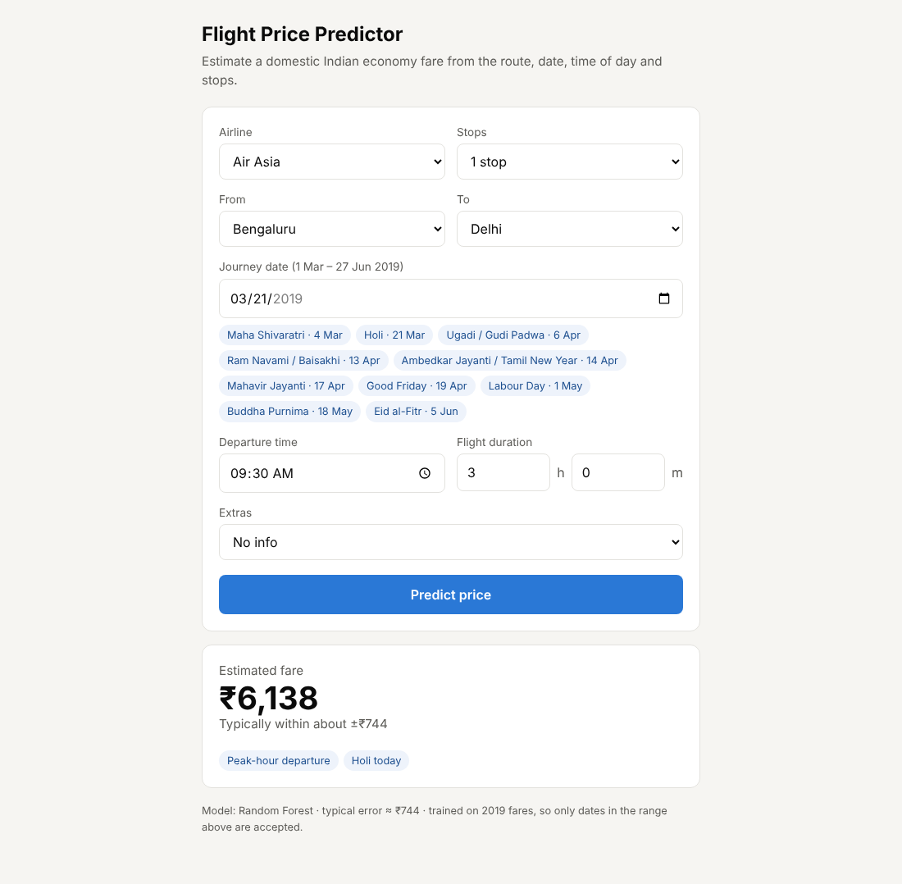
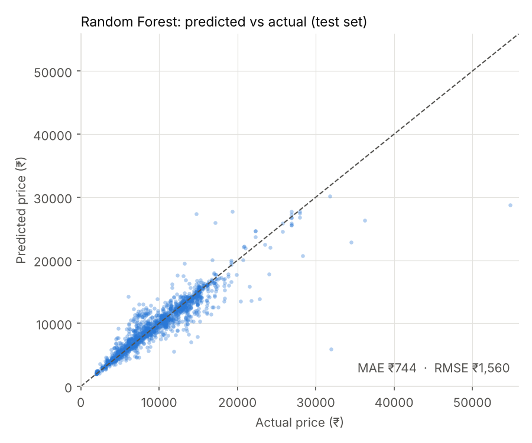
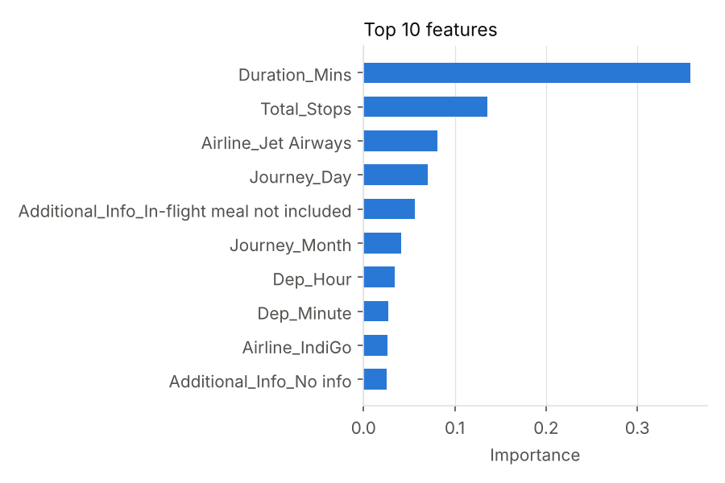

# Flight Price Predictor

A machine-learning web app that estimates a domestic Indian flight fare from the airline, route, journey date, departure time, duration and number of stops. It also adds **peak-time, festival and season features** and tests whether they help.

**Stack:** Python · pandas · scikit-learn · Flask (REST API) · HTML/JS frontend · gunicorn · Docker

## 1. Brief → where it lives

| Brief step | Where |
|---|---|
| 1. Data preparation (cleaning, missing values, feature engineering) | `features.py`, `festivals.py` |
| 2. Model building + MAE / RMSE | `train.py` (section 2) |
| 3. Hyper-parameter tuning (Grid / Random Search) | `train.py` (section 3) |
| 4. REST API (Flask) | `app.py` |
| 5. Web frontend | `templates/index.html` |
| 6. Docker | `Dockerfile`, `.dockerignore`, `requirements.txt` |
| 7. Documentation + testing | this README, `tests/test_app.py` |

```
flight-price-app/
├── app.py                 Flask API + serves the form
├── features.py            cleaning + feature engineering (shared by training and API)
├── festivals.py           hand-made festival calendar (edit me)
├── train.py               train, evaluate, tune, ablation, save model
├── templates/index.html   web form
├── models/                flight_model.joblib + metadata.json (created by train.py)
├── reports/               result plots
├── data/Data_Train.xlsx   dataset
├── tests/test_app.py      pytest suite
├── Dockerfile  .dockerignore  requirements.txt  requirements-dev.txt
```

## 2. Run it

### Locally (Windows, macOS or Linux)

```bash
python -m venv .venv
.venv\Scripts\activate            # Windows   (macOS/Linux: source .venv/bin/activate)
pip install -r requirements-dev.txt
python train.py                   # optional: models/ is already included
python app.py                     # open http://localhost:5000
pytest -q                         # run the tests
```

### With Docker

```bash
docker build -t flight-price-app .
docker run -p 5000:5000 flight-price-app     # open http://localhost:5000
```

The image uses gunicorn inside a Linux container, so it works the same from Windows (Docker Desktop), macOS or Linux. `train.py` is not run inside the image: the trained model in `models/` is copied in.

> **Status:** the Docker build could not be run in the environment this project was written in (no Docker engine available). The app itself was checked in a clean virtual environment containing only the files the Dockerfile copies, but run `docker build` once yourself before submitting.

## 3. API

| Method | Path | Purpose |
|---|---|---|
| GET | `/` | web form |
| GET | `/health` | `{"status": "ok"}` |
| GET | `/meta` | dropdown options, valid date range, model metrics |
| POST | `/predict` | prediction |

```bash
curl -X POST http://localhost:5000/predict -H "Content-Type: application/json" -d '{
  "airline": "IndiGo", "source": "Bengaluru", "destination": "Delhi",
  "journey_date": "2019-04-19", "dep_time": "07:30", "duration_mins": 170,
  "stops": 0, "extras": "No info"
}'
```

```json
{
  "predicted_price_inr": 5010,
  "typical_error_inr": 744,
  "model": "Random Forest",
  "factors": {"is_weekend": false, "is_peak_hour": true, "near_festival": true,
              "nearest_festival": "Good Friday", "days_to_festival": 0,
              "is_summer_peak": false, "festival_window_days": 3}
}
```



Bad input returns **400** with a list of readable messages (unknown airline, a route that isn't in the data, a date outside the training window, a malformed time, and so on). `extras` is optional.

## 4. Workflow

**Data.** The MachineHack *Flight Fare Prediction* dataset: 10,683 flights, 1 Mar – 27 Jun 2019, five Indian routes. It was downloaded as `Data_Train.xlsx` from a public GitHub copy ([divyansh1195/flight-fare-prediction](https://github.com/divyansh1195/flight-fare-prediction)), because Kaggle was not reachable. Check the original MachineHack terms if you publish the project.

**Cleaning** (`clean_raw` in `features.py`), 10,683 → 10,439 rows:

| Problem | Action |
|---|---|
| 1 row with missing `Route` and `Total_Stops` | `Route` is dropped as a feature (redundant); `Total_Stops` imputed with the most common value for the same airline + route |
| 220 exact duplicate rows | dropped. They would also leak between train and test sets and inflate the scores |
| `Banglore` typo, `Delhi` vs `New Delhi` | standardised to `Bengaluru` and `Delhi` |
| `No info` vs `No Info`; rare `Additional_Info` values | merged / pooled into "Other" |
| Business and premium-economy categories (23 rows total) | dropped: too few examples to learn, so the app covers **economy fares only** |
| One 5-minute flight with 2 stops | dropped as a data-entry error |
| Text durations like `2h 50m`, stops like `1 stop` | converted to minutes and integers |

**Feature engineering** (`engineer_features`):

* **Date / time:** day, month, weekday, departure hour and minute
* **Peak-time and festival features:** `Is_Weekend`, `Is_Peak_Hour` (departures 06–10 and 17–21), `Days_To_Festival` (to the nearest of 10 festivals in `festivals.py`, capped at 15), `Near_Festival` (within ±3 days), `Is_Summer_Peak` (from 1 May, school holidays)
* Arrival time is not used, since it is departure time + duration

**Models.** 80/20 split (8,351 train / 2,088 test), same split for every model. Categorical columns are one-hot encoded inside a scikit-learn `Pipeline`, so the API applies exactly the same preprocessing.

**Tuning.** `GridSearchCV` (12 combinations × 3-fold) for Gradient Boosting and `RandomizedSearchCV` (10 samples × 3-fold) for Random Forest, both scored on RMSE. The final model is chosen by cross-validated RMSE on the training data, not by the test set.

## 5. Results

Held-out test set (2,088 flights):

| Model | MAE (₹) | RMSE (₹) | R² |
|---|---|---|---|
| Linear Regression | 1,787 | 2,621 | 0.671 |
| Random Forest, default | 709 | 1,568 | 0.882 |
| Random Forest, **tuned (final)** | 744 | 1,560 | 0.883 |
| Gradient Boosting, default | 1,275 | 2,064 | 0.796 |
| Gradient Boosting, tuned | 813 | 1,564 | 0.883 |

Final model: Random Forest (250 trees, depth 15, `max_features` 0.6). Average error is about **₹744 on a typical fare of ₹9,000**.




**What the numbers say**

* Tree models beat Linear Regression by a wide margin: fares depend on duration, stops and airline in a non-linear way.
* Tuning helped Gradient Boosting a lot (RMSE 2,064 → 1,564) but barely moved Random Forest (RMSE 1,568 → 1,560, and MAE actually got slightly *worse*, 709 → 744). Tuning optimised RMSE, and the default forest was already close to its best. The tuned Random Forest and tuned Gradient Boosting are effectively tied (CV RMSE 1,535 vs 1,544).
* The model **under-predicts very expensive fares** (the points far below the diagonal in the plot). There are few such flights, and forests average toward the middle.

### Did the peak-time and festival features help?

Same Random Forest, three feature sets (5-fold CV on the training set, plus the test set):

| Features | CV RMSE (₹) | Test MAE (₹) | Test R² |
|---|---|---|---|
| Airline, route, stops, duration only | 2,417 | 1,424 | 0.724 |
| + raw date and departure time | 1,496 | 743 | 0.884 |
| + peak / festival / season flags | 1,509 | 744 | 0.883 |

* **Date and time matter a lot.** Adding them cuts the test MAE from ₹1,424 to ₹743.
* **The engineered peak/festival flags add nothing on top of the raw date and time.** Accuracy is the same, within noise. A tree model can already pick out specific days, hours and weekdays from the raw columns, so flags computed from those same columns carry no new information.
* The flags may still pay off if the model were ever trained on several years of data, because "near a festival" carries over to new years while "15 April" does not. That was **not tested** here, since the data covers one 4-month window.
* The flags stay in the app because they are cheap and they power the explanatory chips in the UI (weekend, peak hour, festival, summer season).

## 6. Challenges and limitations

* **No dataset was supplied**, and Kaggle was blocked, so a public copy of the MachineHack data was used.
* **Messy data:** typos, duplicate rows, text-encoded durations and stops, an impossible 5-minute flight. Cleaning is listed above.
* **One window of one year (Mar–Jun 2019).** The API rejects dates outside it, because a model trained on 2019 fares can't price a 2026 flight. To extend it, add that year's festivals to `festivals.py`, train on newer data, and re-run `train.py`.
* **No booking date in the data.** Days-before-departure is one of the strongest real-world fare drivers, but it can't be modelled here.
* **Only 5 routes and 8 airlines**, economy fares only. The API refuses routes it has not seen.
* **Festival dates were compiled by hand** for 2019 (check them against an official calendar). The ±3-day window covers about 47% of the dates in the data, so "near a festival" is not a very selective flag. The 2019 general election (April–May) is not modelled.
* **Single train/test split.** Cross-validation was used inside tuning and the ablation, but the headline test numbers come from one split.

## 7. Testing

`pytest -q` runs 19 tests (all pass):

* **Features:** duration parsing, festival/peak/weekend flags on a known date (Holi 2019), cleaning removes bad rows
* **API usability:** `/health`, form page loads, `/meta` options, valid prediction, and clear 400 errors for an unknown airline, an unseen route, an out-of-range date, a bad date format, a bad time, an impossible duration, too many stops, unknown extras, missing fields and a non-JSON body
* **Accuracy:** the saved model's held-out MAE stays under ₹1,000 and R² above 0.85

Manual usability check (done in a headless browser at desktop and phone width): dropdowns fill from the API; choosing a source limits the destinations to valid ones; clicking a festival chip sets the date; a result shows the price, typical error and flags; an out-of-range date shows a readable error instead of crashing; the layout fits a 390 px wide screen.
